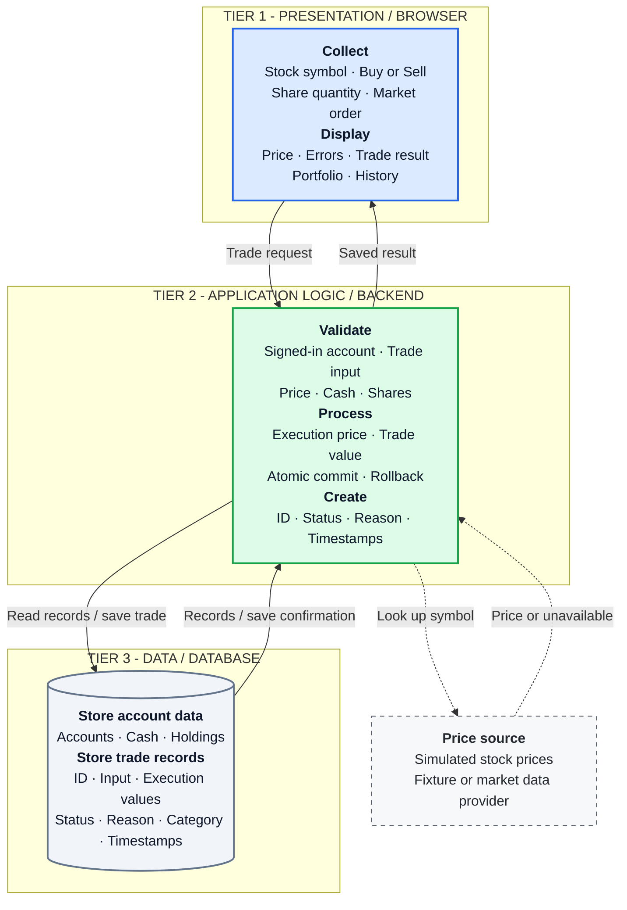

# MarketStreet — Three-Tier Architecture

**Presentation collects and displays. Application logic validates and decides. Data stores the official records.**

Only the application accesses the database. The price source supplies the application with prices; it is a dependency outside the three tier boxes. Prices from the price source are never taken from the browser, so the user cannot choose their own execution price (BR-9).

**Implementation status:** This is the proposed architecture. The [current prototype](../../Testing/Trade-UI/trade-ui.js) runs entirely in the browser; the backend and persistent database are planned. Until the prototype is updated, it still offers Limit orders and does not follow BR-9.

Details: [Trade workflow](workflow.md) · [Data dictionary](data-dictionary.md) · [Trade states](state-diagram.md) · [Responsibility notes](short-responsibility-notes.md).
