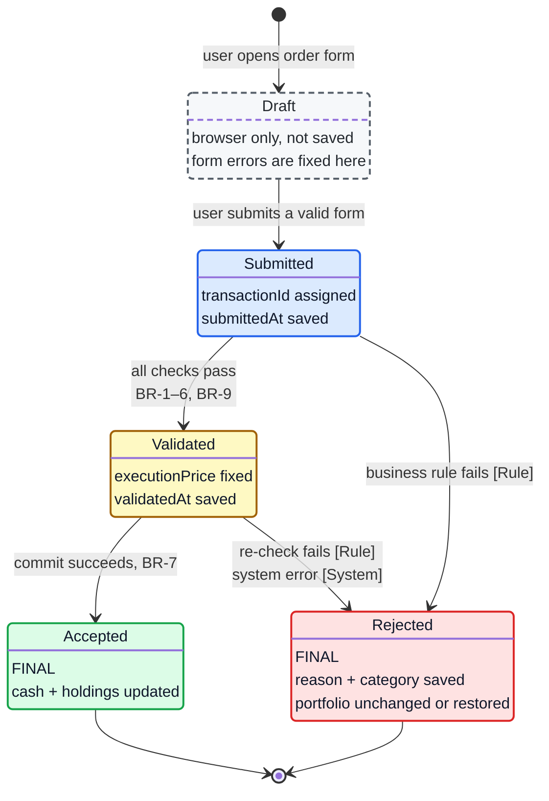
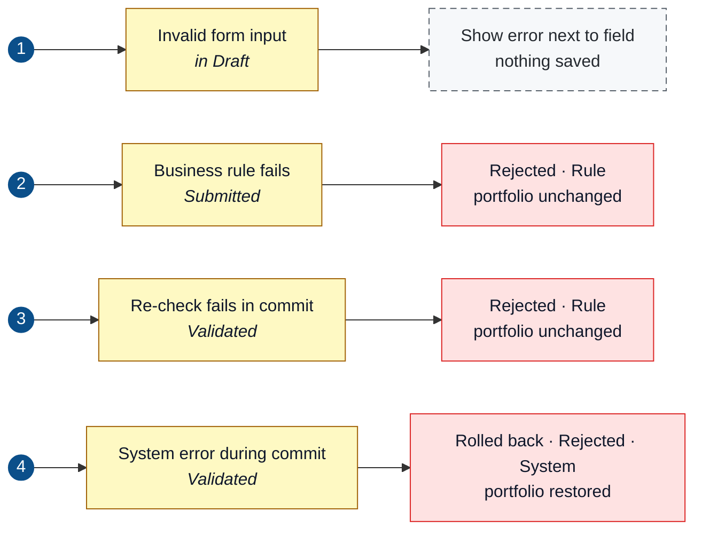

# MarketStreet — State Transition Diagram

A trade has four official statuses: **Submitted, Validated, Accepted, Rejected**. **Draft** (dashed border) is shown for context only: it is the unsent form in the browser, it is not a status value, and it is never saved.

**How to read it:** each arrow is a transition, labeled with what causes it. `[Rule]` and `[System]` are the `rejectionCategory` saved with a Rejected trade. Accepted and Rejected are final, so both lead to the end marker; a corrected order starts over as a new transaction.

## Exception / Failure Paths

The following paths show how MarketStreet handles errors that interrupt the normal transaction flow. Exception 1 occurs before a transaction record exists. Exceptions 2, 3, and 4 occur after submission and result in the transaction entering the **Rejected** state.

| Exception | Happens at | Trigger | Result |
|---|---|---|---|
| **Exception 1 — Invalid Input** | **Draft** | The user enters invalid form data, such as an invalid trade type, stock symbol, or quantity (BR-1 to BR-3). | Display an error message. The order remains in **Draft** and nothing is saved. |
| **Exception 2 — Business Rule Validation Failure** | **Submitted → Rejected** | The application rejects the submitted trade during validation (BR-1 to BR-6, BR-9), such as insufficient cash, insufficient shares, an invalid or stale stock price, or a Limit order. | Set the status to **Rejected** with category **Rule** and a reason. Cash and holdings remain unchanged. |
| **Exception 3 — Re-check Fails Inside Commit** | **Validated → Rejected** | Between validation and commit, another order from the same account used the cash or shares, so BR-4 or BR-5 fails when re-checked against the locked account. | Abort the commit. Set the status to **Rejected** with category **Rule** and a reason. Cash and holdings remain unchanged. |
| **Exception 4 — System Error During Commit** | **Validated → Rejected** | A technical failure (for example, the database connection drops or the server crashes) occurs while committing the validated trade (BR-7 / BR-8). | Roll back the commit, set the status to **Rejected** with category **System**, and keep cash and holdings at their previous values. |

## States

| State | Where it lives | Saved? | Final? |
|---|---|---|---|
| **Draft** | Browser (the user's unsent order form) | No — no record, no transactionId | No |
| **Submitted** | Application | Yes | No |
| **Validated** | Application | Yes | No |
| **Accepted** | Application | Yes | Yes |
| **Rejected** | Application | Yes, with the reason and category | Yes |

**Draft** has a dashed border because it exists only in the browser. Form errors (BR-1 to BR-3) keep the order in Draft until the user fixes them, so nothing is saved. Once the user submits, the application re-checks BR-1 to BR-3 because browser checks can be bypassed, and checks BR-4 to BR-6 and BR-9, which require application data. A corrected order after a rejection is a new transaction with a new transactionId; final records are never reopened.

## Business Rules on this Diagram

| Rule | Meaning | Where it appears |
|---|---|---|
| BR-1 | Trade type must be Buy or Sell | Draft (browser check), Submitted → Validated / Rejected |
| BR-2 | Stock symbol must be recognized | Draft (browser check), Submitted → Validated / Rejected |
| BR-3 | Share quantity must be a positive whole number | Draft (browser check), Submitted → Validated / Rejected |
| BR-4 | Enough simulated cash for a Buy | Submitted → Validated / Rejected; re-checked at Validated → Accepted / Rejected |
| BR-5 | Enough shares owned for a Sell | Submitted → Validated / Rejected; re-checked at Validated → Accepted / Rejected |
| BR-6 | A valid stock price (> $0, ≤ 15 minutes old) is required | Submitted → Validated / Rejected |
| BR-7 | Accepted trades update cash, holdings, and the record in one atomic commit | Validated → Accepted |
| BR-8 | Rejected trades change nothing; a failed commit is rolled back | Submitted / Validated → Rejected |
| BR-9 | Only Market orders are executed | Submitted → Validated / Rejected |

Rule numbers match [business-rules.md](../02-requirements/business-rules.md).