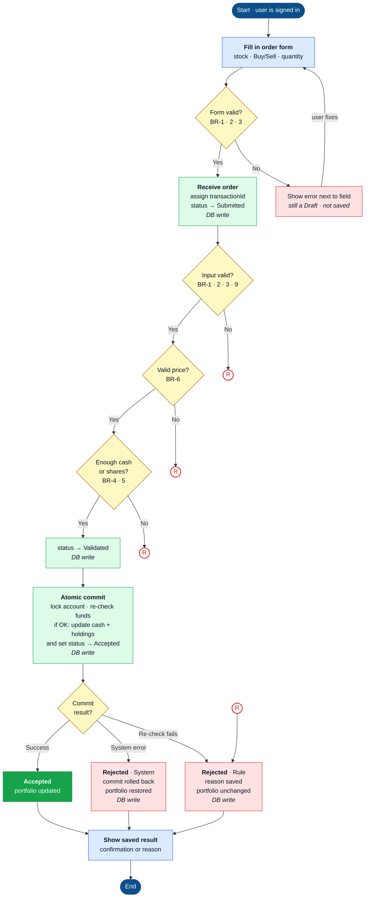

# MarketStreet — Stock Trade Order Workflow

**Main transaction:** User submits a simulated stock trade order (Market order).

## Legend

| Symbol | Meaning |
|---|---|
| Dark blue pill | Start / End |
| Blue box | **Presentation tier** (browser) step |
| Green box | **Application tier** step |
| Yellow diamond | Decision |
| Solid green box | Successful outcome |
| Red box | Error or rejection |
| Red circle **R** | Connector: continues at the **R** above "Rejected · Rule" |
| *DB write* | The step writes to the **data tier** (see table below) |

## Database Writes (Data Tier)

Only the application writes to the database. Each *DB write* in the diagram is one of these writes.

| Step | What is saved | Notes |
|---|---|---|
| Receive order | New transaction record, status `Submitted`, `submittedAt` | If this save fails, no trade exists; the user is told the system is unavailable. |
| Validated | Status `Validated`, `validatedAt`, execution price, value, price timestamp | |
| Atomic commit | Cash balance + holdings + status `Accepted`, `completedAt` | **One database transaction.** Either all of it is saved or none of it. |
| Rejected · Rule | Status `Rejected`, `rejectionReason`, `rejectionCategory = Rule`, `completedAt`; execution price, value, and price timestamp if a valid price was obtained | Cash and holdings are never touched. |
| Rejected · System | Status `Rejected`, `rejectionReason`, `rejectionCategory = System`, `completedAt` | Saved after the failed commit is rolled back. |

## Business Rules

| Rule | Meaning |
|---|---|
| BR-1 | Trade type is Buy or Sell. |
| BR-2 | Stock symbol is recognized. |
| BR-3 | Quantity is a positive whole number. |
| BR-4 | Buy orders have enough cash to cover the trade (re-checked inside the commit). |
| BR-5 | Sell orders have enough shares owned (re-checked inside the commit). |
| BR-6 | A valid stock price is available: greater than $0 and no more than 15 minutes old. |
| BR-7 | Accepted trades update cash, holdings, and the Accepted record in one atomic commit. |
| BR-8 | Rejected trades leave cash and holdings unchanged; a failed commit is rolled back. |
| BR-9 | Only Market orders are executed; Limit orders are rejected. |

## Save Rules

1. **One commit for an accepted trade.** Cash, holdings, and the Accepted record are written in one database transaction. Either all three are saved or none are. The diagram has no path where the portfolio changes but the record does not (or the reverse).
2. **Check again inside the commit.** The account row is locked and BR-4 / BR-5 are re-checked inside the commit. Two orders submitted at the same time cannot both spend the same cash or sell the same shares.
3. **Save before showing.** The user sees a result only after it has been saved, for both Accepted and Rejected trades.
4. **Two kinds of rejection.** `Rule` means the order broke a business rule. `System` means the order was valid but the commit failed and was rolled back. Both end in the Rejected status, and the category keeps them apart in history and audits.
5. **If a save itself fails.** If the database cannot save a record at all (for example, the Submitted record), the user is told the system is unavailable and to try again. No result is claimed, and the user's cash and holdings are not touched.

Details: [Business rules](../02-requirements/business-rules.md) · [Trade states and exception paths](state-diagram.md) · [Three-tier architecture](architecture.md) · [Data dictionary](data-dictionary.md).
